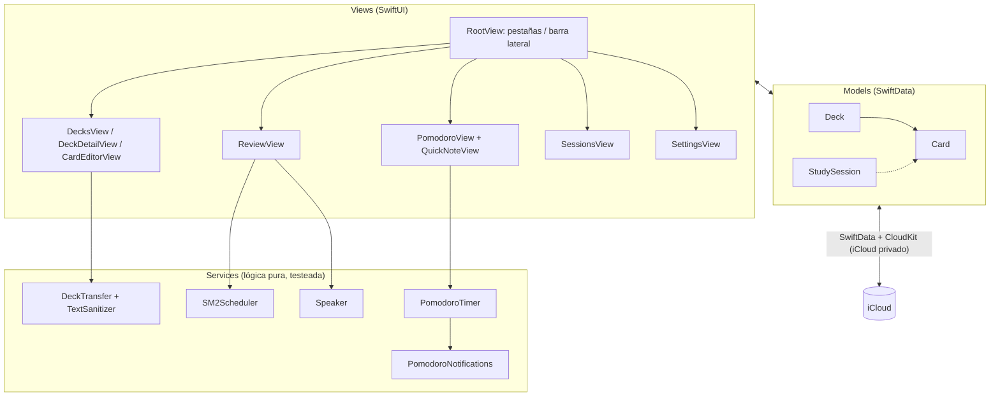

# Arquitectura y funcionamiento del código

## Vista general



**Patrón:** SwiftUI con datos de SwiftData directamente en las vistas (`@Query`,
`@Bindable`), que es el enfoque que recomienda Apple. La lógica que vale la pena
testear (algoritmo, temporizador, importación) está en `Services/` como tipos
**puros** (sin interfaz y con la fecha `now` inyectada), con tests en `MnemoTests/`.

Un solo target "Multiplatform": el mismo código corre en iPhone, iPad y Mac. Las
pocas diferencias se resuelven con `#if os(macOS)` (por ejemplo, el repaso se
abre en pantalla completa en iOS y como hoja en Mac).

## Modelo de datos

```mermaid
erDiagram
    Deck ||--o{ Card : "cards (borrado en cascada)"
    StudySession |o--o{ Card : "cards (nullify: borrar sesión no borra tarjetas)"
    Deck { UUID id; String name; String languageCode; Date createdAt }
    Card { UUID id; String front; String back; String pronunciation; String example; String kindRaw; String genderRaw; Date dueDate; Double intervalDays; Double ease; Int repetitions; Int lapses; Date lastReviewedAt }
    StudySession { UUID id; Date startedAt; Date endedAt; Int pomodorosCompleted }
```

Reglas que impone CloudKit y que el modelo respeta:
- Toda propiedad tiene valor por defecto o es opcional.
- Toda relación es opcional (`[Card]?`, `Deck?`).
- Sin `@Attribute(.unique)`.
- Los enums (`WordKind`, `GrammaticalGender`) se guardan como `String` y se exponen
  con propiedades calculadas (`card.kind`), así agregar casos no rompe datos existentes.

## Sincronización entre dispositivos

`Persistence.makeContainer()` crea el `ModelContainer` con
`cloudKitDatabase: .automatic`:

1. SwiftData guarda en una base SQLite local (la app funciona sin conexión).
2. En segundo plano, replica los cambios a la **base privada** de CloudKit del
   usuario, usando el contenedor declarado en los entitlements.
3. Los otros dispositivos reciben una notificación silenciosa (por eso la capacidad
   *Remote notifications*) y descargan los cambios; `@Query` refresca las vistas solo.
4. Si iCloud no está disponible, cae a modo local (`cloudKitDatabase: .none`) y lo registra en el log.

Conflictos: CloudKit aplica "el último cambio gana" por campo. Para esta app es
suficiente (es raro editar la misma tarjeta en dos dispositivos a la vez).

**Qué se sincroniza:** mazos, tarjetas (incluido el progreso de repaso) y sesiones.
**Qué no:** el estado del temporizador Pomodoro y las preferencias (`UserDefaults`), que son de cada dispositivo.

## Algoritmo de repaso (SM-2)

Archivo: `Services/SM2Scheduler.swift`. Basado en SuperMemo-2 (P. Wozniak, 1987),
el algoritmo que originó Anki, adaptado a 4 botones.

Cada tarjeta guarda: `intervalDays`, `ease` (facilidad, empieza en 2.5),
`repetitions` (aciertos seguidos), `lapses` (olvidos) y `dueDate`.

| Botón | Ease | Intervalo nuevo |
|---|---|---|
| Otra vez | −0.20 | 10 minutos; `repetitions = 0`, `lapses += 1` |
| Difícil | −0.15 | 1 día si es nueva; si no, intervalo × 1.2 |
| Bien | = | 1 día → 6 días → intervalo × ease |
| Fácil | +0.15 | 4 días si es nueva; si no, intervalo × ease × 1.3 |

- La ease nunca baja de 1.3; el intervalo se redondea a días enteros y tiene tope de 10 años.
- `ReviewView` toma las tarjetas con `dueDate <= ahora` (máx. 200), ordenadas por vencimiento.
- "Otra vez" vuelve a encolar la tarjeta al final de la sesión actual.
- `Card.schedulingState` es el puente entre el modelo guardado y el algoritmo puro.

Ejemplo con "Bien" siempre: hoy → +1 d → +6 d → +15 d → +38 d → +95 d…

## Pomodoro

Archivo: `Services/PomodoroTimer.swift` (`@Observable`, compartido por toda la app vía `.environment`).

- Guarda `endDate` (hora de fin) en lugar de descontar segundos: el restante es
  `endDate − ahora`, correcto aunque iOS suspenda la app.
- `PomodoroView` llama a `tick(now:)` cada segundo y al volver a primer plano; si
  la fase terminó, avanza: foco → descanso corto, y cada N focos → descanso largo.
- Al empezar una fase se programa una notificación local para `endDate`; al pausar,
  saltar o reiniciar, se cancela.
- `completedFocusCount` es observado por la vista para sumar el 🍅 a la sesión activa.

## Sesiones de estudio

- La sesión activa es la `StudySession` con `endedAt == nil` (consulta con `#Predicate`),
  así una sesión abierta en un dispositivo aparece activa en los demás.
- `QuickNoteView` crea una `Card` con `deck` (el elegido o "Anotaciones") y `session`.

## Importación / exportación

Archivo: `Services/DeckTransfer.swift`.

- **Formato propio:** JSON versionado (`DeckExport`, `version: 1`). Solo contenido, sin progreso.
- **Anki:** texto plano separado por tabulaciones, `#` = encabezado, HTML simple eliminado.
- **Pipeline de importación:** tamaño ≤ 5 MB → decodificar → versión soportada →
  `sanitized` (limpia cada campo, descarta vacías, valida tipo/género, ≤ 20.000 tarjetas)
  → `insert` en la base. Todo error se traduce a un mensaje legible (`DeckTransferError`).
- **Exportación:** escribe un archivo temporal con protección de datos y lo
  comparte con `ShareLink`. El nombre se filtra para evitar caracteres de ruta.

## Colores

`Theme/Palette.swift` define la paleta; cada tipo (`WordKind`, `GrammaticalGender`,
`ReviewGrade`, fase del Pomodoro) tiene su `color` en una extensión. Razones en
[COLORES.md](COLORES.md).

## Tests

| Archivo | Qué verifica |
|---|---|
| `SM2SchedulerTests` | Intervalos 1→6→×ease, reinicio al olvidar, ease mínima, tope, formato de etiquetas |
| `PomodoroTimerTests` | Restante calculado por hora de fin, pausa, ciclo foco/descanso/largo, saltar |
| `DeckTransferTests` | Ida y vuelta JSON, versión futura, basura, sanitización, formato Anki, nombres de archivo seguros |

Correr con **⌘U** en Xcode.

## Ideas para seguir

- Límite diario de tarjetas nuevas y estadísticas (racha, retención).
- Algoritmo FSRS (el que usa Anki moderno) como alternativa a SM-2.
- Widget con el Pomodoro / Live Activity.
- Importar `.apkg` de Anki (es un SQLite comprimido; requiere más validación).
