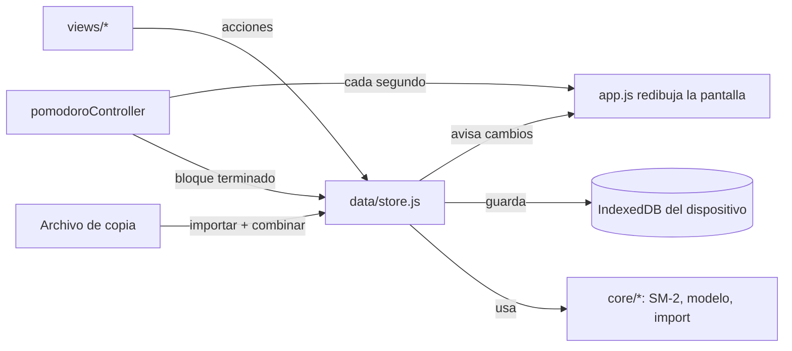

# Versión web: cómo funciona el código

La versión web (`web/`) es una **PWA** (aplicación web progresiva): HTML, CSS y
JavaScript sin frameworks ni dependencias externas, que se instala desde el
navegador y funciona sin conexión. Los casos de uso son los mismos que los de la
app nativa ([CASOS_DE_USO.md](CASOS_DE_USO.md)); las diferencias están al final.

## Estructura

```
web/
├── public/                     Lo que se publica
│   ├── index.html              Página única + política de seguridad (CSP)
│   ├── manifest.webmanifest    Nombre, ícono y modo pantalla completa al instalar
│   ├── _headers                Cabeceras de seguridad (Netlify / Cloudflare Pages)
│   ├── css/app.css             Estilos y paleta (mismos colores que la app nativa)
│   ├── fonts/                  Tipografías propias (sin pedir nada a Google)
│   ├── icons/                  Íconos de la app
│   └── js/
│       ├── app.js              Arranque, navegación, reloj, instalación
│       ├── core/               Lógica pura, sin navegador (tiene pruebas)
│       │   ├── sm2.js          Algoritmo de repaso espaciado
│       │   ├── pomodoro.js     Máquina de estados del temporizador
│       │   ├── model.js        Mazos/tarjetas/sesiones, consultas y combinación (sync)
│       │   ├── transfer.js     Importar y exportar (Mnemo, Anki, copia completa)
│       │   └── sanitize.js     Limpieza de texto y validaciones
│       ├── data/
│       │   ├── storage.js      IndexedDB (con respaldo en localStorage)
│       │   └── store.js        Estado en memoria + todas las acciones que lo cambian
│       ├── services/           Voz, sonido, pantalla encendida, archivos, Pomodoro
│       ├── ui/                 Ayudantes de DOM, componentes, hojas y avisos
│       └── views/              Pantallas: mazos, repaso, Pomodoro, sesiones, ajustes
├── src/sw.template.js          Service worker (modo sin conexión)
├── scripts/build.mjs           Arma dist/ y dist-preview/
├── scripts/serve.mjs           Servidor local con las cabeceras de producción
└── tests/                      core.test.mjs (lógica) y e2e.mjs (navegador real)
```

## Flujo de datos



- **Una sola fuente de verdad:** `store.js` tiene el estado en memoria. Las vistas
  nunca lo modifican directo: llaman a una acción (`createCard`, `rateCard`…), que
  pone `updatedAt`, avisa a la interfaz y guarda enseguida.
- **Guardado:** todo el estado se escribe como un solo registro en IndexedDB. Los
  cambios del mismo instante se agrupan en una escritura. Se fuerza el guardado al
  pasar la app a segundo plano.
- **Redibujo:** cada pantalla es una función que devuelve elementos del DOM. Al
  cambiar el estado se vuelve a dibujar la pantalla actual, conservando el foco y
  el cursor si el usuario estaba escribiendo.

## Sincronización por archivo

Cada mazo, tarjeta y sesión tiene `id` y `updatedAt`. Borrar no elimina el
registro: lo convierte en una "lápida" (`{ id, deleted: true, updatedAt }`) para
que el borrado viaje al otro dispositivo. `mergeStates` recorre la copia importada
y, por cada `id`, se queda con la versión de `updatedAt` más nuevo (en empate, la
local). Es idempotente: importar la misma copia dos veces no cambia nada. Las
lápidas de más de 180 días se limpian al abrir la app.

## Repaso (SM-2)

Igual que la versión nativa: ver [ARQUITECTURA.md](ARQUITECTURA.md#algoritmo-de-repaso-sm-2).
En la web se agregó **deshacer** (botón o tecla Z): guarda una copia de la tarjeta
antes de calificarla y la restaura.

## Pomodoro

`core/pomodoro.js` guarda la hora de fin (`endAt`), no un contador, así el tiempo
es exacto aunque el navegador congele la app. El estado se guarda en el
dispositivo y sobrevive si iOS cierra la app; al volver, si la fase terminó, se
procesa en ese momento. Mientras corre, se pide al sistema mantener la pantalla
encendida (Wake Lock) para que el aviso suene a tiempo: en iPhone/iPad las apps
web no pueden ejecutar código ni notificar con la pantalla apagada.

## Modo sin conexión

`scripts/build.mjs` calcula un número de versión a partir del contenido de los
archivos y genera `sw.js` con la lista completa. Al instalarse, el service worker
guarda todos los archivos en un caché propio de esa versión; las páginas se sirven
desde ahí. Cuando se publica una versión nueva, se descarga entera, se activa y la
app se recarga una vez (después de guardar los datos).

## Seguridad

- **Sin servidor, sin cuentas, sin claves:** no hay nada que filtrar del lado del servidor.
- **CSP estricta** (en `_headers` y en `index.html`): solo se ejecuta código de la propia
  app; nada en línea ni de terceros. Ni las tipografías se piden a otro sitio.
- **El texto del usuario nunca se interpreta como HTML:** `ui/dom.js` crea todo con
  nodos de texto (no hay `innerHTML` en la app). La prueba de navegador verifica que
  una tarjeta con `` se muestre literal.
- **Importaciones como datos no confiables:** límites de tamaño (5 MB por mazo,
  25 MB por copia) y de cantidad, ids validados, números y fechas acotados, texto
  limpiado (`sanitize.js`).
- **Otras cabeceras:** `nosniff`, sin referrer, sin cámara/micrófono/ubicación,
  la app no se puede embeber en otro sitio.

## Pruebas

| Archivo | Qué verifica |
|---|---|
| `tests/core.test.mjs` | SM-2, Pomodoro, sanitización, consultas, combinación de copias, importación (Anki, nativa, archivos maliciosos) |
| `tests/e2e.mjs` | En Chromium a tamaño iPhone (claro) e iPad (oscuro): alta de tarjeta, XSS, repaso con deshacer, Pomodoro y anotación, sesiones, exportar/importar, datos tras recargar, modo sin conexión, sin desbordes horizontales ni errores de consola |

## Diferencias con la app nativa

| Tema | Web | Nativa |
|---|---|---|
| Datos | IndexedDB del navegador | SwiftData |
| Sincronización | Manual por archivo, con combinación | Automática por iCloud |
| Aviso del Pomodoro con la app cerrada | No disponible | Notificación local |
| Deshacer en el repaso | Sí | No |
| Formato de mazo exportado | El mismo (compatibles) | El mismo |
