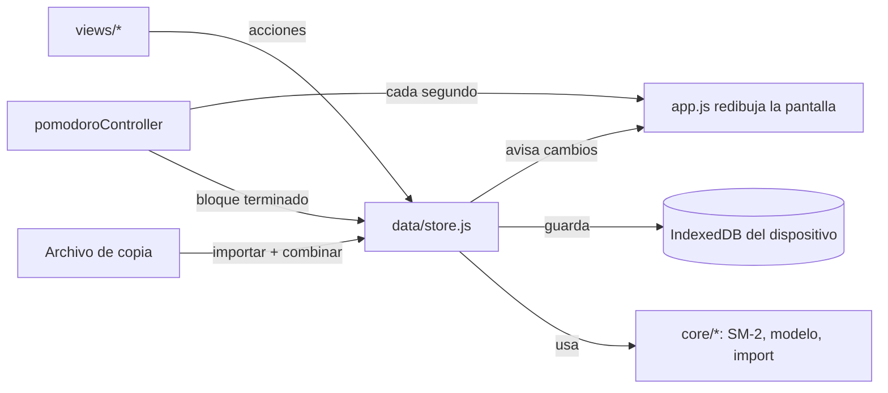

# Versión web: cómo funciona el código

La versión web (`web/`) es una **PWA** (aplicación web progresiva): HTML, CSS y
JavaScript sin frameworks ni dependencias externas, que se instala desde el
navegador y funciona sin conexión. Los casos de uso son los mismos que los de la
app nativa ([CASOS_DE_USO.md](CASOS_DE_USO.md)); las diferencias están al final.

## Estructura

```
web/
├── public/                     Lo que se publica
│   ├── index.html              Página única + política de seguridad (CSP)
│   ├── manifest.webmanifest    Nombre, ícono y modo pantalla completa al instalar
│   ├── _headers                Cabeceras de seguridad (Netlify / Cloudflare Pages)
│   ├── css/app.css             Estilos y paleta (mismos colores que la app nativa)
│   ├── fonts/                  Tipografías propias (sin pedir nada a Google)
│   ├── icons/                  Íconos de la app
│   ├── strokes/                Trazos de kana y kanji (KanjiVG, CC BY-SA 3.0)
│   └── js/
│       ├── app.js              Arranque, navegación, reloj, instalación
│       ├── core/               Lógica pura, sin navegador (tiene pruebas)
│       │   ├── sm2.js          Algoritmo de repaso espaciado
│       │   ├── pomodoro.js     Máquina de estados del temporizador
│       │   ├── model.js        Mazos/tarjetas/sesiones, consultas y combinación (sync)
│       │   ├── transfer.js     Importar y exportar (Mnemo, Anki, copia completa, preguntas)
│       │   ├── sanitize.js     Limpieza de texto y validaciones
│       │   ├── japanese.js     Kana, romaji → kana y corrección tolerante de respuestas
│       │   ├── strokes.js      Comparación de trazos dibujados con los de referencia
│       │   └── practice.js     Palabras para practicar a partir de las tarjetas
│       ├── data/
│       │   ├── storage.js      IndexedDB (con respaldo en localStorage)
│       │   └── store.js        Estado en memoria + todas las acciones que lo cambian
│       ├── services/           Voz, sonido, pantalla encendida, archivos, Pomodoro
│       ├── ui/                 Ayudantes de DOM, componentes, hojas y avisos
│       └── views/              Pantallas: mazos, repaso, Pomodoro, sesiones, ajustes
│           └── practice/       Práctica: escritura, preguntas, pronunciación y escucha
├── src/sw.template.js          Service worker (modo sin conexión)
├── scripts/build.mjs           Arma dist/ y dist-preview/
├── scripts/serve.mjs           Servidor local con las cabeceras de producción
├── scripts/strokes-from-kanjivg.mjs  Regenera public/strokes/ desde KanjiVG
└── tests/                      *.test.mjs (lógica), e2e.mjs y e2e-practice.mjs (navegador real)
```

## Flujo de datos



- **Una sola fuente de verdad:** `store.js` tiene el estado en memoria. Las vistas
  nunca lo modifican directo: llaman a una acción (`createCard`, `rateCard`…), que
  pone `updatedAt`, avisa a la interfaz y guarda enseguida.
- **Guardado:** todo el estado se escribe como un solo registro en IndexedDB. Los
  cambios del mismo instante se agrupan en una escritura. Se fuerza el guardado al
  pasar la app a segundo plano.
- **Redibujo:** cada pantalla es una función que devuelve elementos del DOM. Al
  cambiar el estado se vuelve a dibujar la pantalla actual, conservando el foco y
  el cursor si el usuario estaba escribiendo.

## Sincronización por archivo

Cada mazo, tarjeta y sesión tiene `id` y `updatedAt`. Borrar no elimina el
registro: lo convierte en una "lápida" (`{ id, deleted: true, updatedAt }`) para
que el borrado viaje al otro dispositivo. `mergeStates` recorre la copia importada
y, por cada `id`, se queda con la versión de `updatedAt` más nuevo (en empate, la
local). Es idempotente: importar la misma copia dos veces no cambia nada. Las
lápidas de más de 180 días se limpian al abrir la app.

## Repaso (SM-2)

Igual que la versión nativa: ver [ARQUITECTURA.md](ARQUITECTURA.md#algoritmo-de-repaso-sm-2).
En la web se agregó **deshacer** (botón o tecla Z): guarda una copia de la tarjeta
antes de calificarla y la restaura.

## Pomodoro

`core/pomodoro.js` guarda la hora de fin (`endAt`), no un contador, así el tiempo
es exacto aunque el navegador congele la app. El estado se guarda en el
dispositivo y sobrevive si iOS cierra la app; al volver, si la fase terminó, se
procesa en ese momento. Mientras corre, se pide al sistema mantener la pantalla
encendida (Wake Lock) para que el aviso suene a tiempo: en iPhone/iPad las apps
web no pueden ejecutar código ni notificar con la pantalla apagada.

## Práctica

Cinco ejercicios en la pestaña **Práctica**. Los que usan audio o escritura a mano
corren en una capa a pantalla completa (`ui/layer.js`), fuera de la pantalla
principal, así un cambio de datos (por ejemplo, que termine un Pomodoro) no los
reinicia.

### Escritura (`views/practice/writing.js`)

- **Datos:** los trazos vienen de [KanjiVG](https://kanjivg.tagaini.net) (orden de
  trazos japonés). `scripts/strokes-from-kanjivg.mjs` los guarda en
  `public/strokes/<bloque>.json`, un archivo por cada 256 códigos Unicode
  (`030.json` = kana; los kanji en 83 archivos, 6,5 MB en total). La app pide solo
  el bloque que necesita; el de kana se instala con la app y los de kanji los
  guarda el service worker la primera vez que se usan (caché `mnemo-strokes-v1`,
  que no se borra al actualizar la app).
- **Animación:** cada trazo es un `<path>` SVG que se dibuja animando
  `stroke-dashoffset`, con el número de orden al lado.
- **Corrección:** se dibuja con eventos de puntero (dedo, mouse o Apple Pencil; si
  aparece el lápiz, se ignoran los toques de la palma). Al levantar el dedo, el
  trazo se compara con el que corresponde según el orden (`core/strokes.js`):
  ambos se re-muestrean a 32 puntos equidistantes y se mide la distancia promedio
  entre puntos. Cuenta como bien si la distancia queda bajo un umbral que crece
  con el largo del trazo y si el largo es parecido. Si coincide mejor al revés,
  avisa que la dirección está invertida. Tras dos errores en el mismo trazo,
  se anima ese trazo como pista.
- Guarda cuántas veces practicaste cada carácter (preferencia local) y lo marca
  en la grilla (punto amarillo: practicado; verde: alguna vez sin errores).

### Preguntas (`views/practice/quizzes.js`)

Cuestionarios (`quizzes` en el modelo, se sincronizan como el resto):
`{ id, name, questions: [{ prompt, answers[], note }] }`. Se crean a mano, se
importan desde texto (`pregunta⇥respuesta1 / respuesta2⇥nota`) o se generan
desde un mazo (español → japonés o japonés → español). Las preguntas falladas
vuelven a aparecer al final.

**Corrección tolerante** (`core/japanese.js`, `matchesAnswer`): da igual hiragana,
katakana o romaji (`neko` = `ねこ` = `ネコ`), espacios, puntuación y vocales largas
(`koohii` = `コーヒー`, `sensee` = `せんせい`); en español, mayúsculas y tildes.
`すき（な）` acepta `すき` y `すきな`; `comer; tomar` acepta cada significado.

### Pronunciación (`views/practice/audio.js`)

Tres formas, porque no todas funcionan en todos lados:

1. **Reconocimiento de voz del navegador** (`SpeechRecognition`, japonés). Funciona
   en Safari y Chrome. **Apple no lo habilita en las apps agregadas a la pantalla
   de inicio** (WebKit bug 225298), así que en la app instalada no aparece.
2. **Dictado del teclado:** se toca el campo y se usa el micrófono del teclado
   japonés. Funciona también en la app instalada.
3. **Grabarme y comparar:** graba con el micrófono, reproduce la grabación junto al
   modelo y uno mismo marca si salió bien. El audio no sale del dispositivo.

Lo reconocido se compara con la lectura en kana, el kanji y lo escrito en la
tarjeta (también `1時` = `一時`).

### Escucha

- **Dictado:** la voz del sistema dice una palabra; se escribe lo que se oyó.
  Se puede repetir y escuchar más lento.
- **¿Qué escuchaste?:** se elige el significado entre cuatro opciones (los otros
  tres salen del mismo mazo).

Las palabras salen de las tarjetas (`core/practice.js`): de las de vocabulario,
la lectura en kana, el kanji y el significado; de las de kanji, sus palabras de
ejemplo. Si el dispositivo no tiene voz japonesa, la app explica cómo instalarla.

## Modo sin conexión

`scripts/build.mjs` calcula un número de versión a partir del contenido de los
archivos y genera `sw.js` con la lista completa. Al instalarse, el service worker
guarda todos los archivos en un caché propio de esa versión; las páginas se sirven
desde ahí. Cuando se publica una versión nueva, se descarga entera, se activa y la
app se recarga una vez (después de guardar los datos).

## Seguridad

- **Sin servidor, sin cuentas, sin claves:** no hay nada que filtrar del lado del servidor.
- **CSP estricta** (en `_headers` y en `index.html`): solo se ejecuta código de la propia
  app; nada en línea ni de terceros. Ni las tipografías se piden a otro sitio.
- **El texto del usuario nunca se interpreta como HTML:** `ui/dom.js` crea todo con
  nodos de texto (no hay `innerHTML` en la app). La prueba de navegador verifica que
  una tarjeta con `` se muestre literal.
- **Importaciones como datos no confiables:** límites de tamaño (5 MB por mazo,
  25 MB por copia) y de cantidad, ids validados, números y fechas acotados, texto
  limpiado (`sanitize.js`).
- **Otras cabeceras:** `nosniff`, sin referrer, sin cámara ni ubicación (el
  micrófono solo para la propia app), la app no se puede embeber en otro sitio.
- **Micrófono:** se pide permiso recién al tocar "Decirlo" o "Grabarme". Las
  grabaciones quedan en memoria y se descartan al salir. El reconocimiento de voz
  automático lo hace el navegador (Apple o Google) y puede enviar el audio a sus
  servidores: la app lo avisa antes de empezar.

## Pruebas

| Archivo | Qué verifica |
|---|---|
| `tests/core.test.mjs` | SM-2, Pomodoro, sanitización, consultas, combinación de copias, importación (Anki, nativa, archivos maliciosos) |
| `tests/practice.test.mjs` | Romaji → kana, corrección tolerante, comparación de trazos (bien, lejos, al revés, puntos), palabras desde tarjetas, cuestionarios en la copia |
| `tests/e2e-practice.mjs` | En Chromium (iPad horizontal y celular): trazos simulados de あ, い (mal) y 曜, generar y responder preguntas, dictado, "¿qué escuchaste?", pronunciación con dictado del teclado |
| `tests/e2e.mjs` | En Chromium a tamaño iPhone (claro) e iPad (oscuro): alta de tarjeta, XSS, repaso con deshacer, Pomodoro y anotación, sesiones, exportar/importar, datos tras recargar, modo sin conexión, sin desbordes horizontales ni errores de consola |

## Diferencias con la app nativa

| Tema | Web | Nativa |
|---|---|---|
| Datos | IndexedDB del navegador | SwiftData |
| Sincronización | Manual por archivo, con combinación | Automática por iCloud |
| Aviso del Pomodoro con la app cerrada | No disponible | Notificación local |
| Deshacer en el repaso | Sí | No |
| Práctica (escritura, preguntas, pronunciación, escucha) | Sí | No (por ahora) |
| Formato de mazo exportado | El mismo (compatibles) | El mismo |
