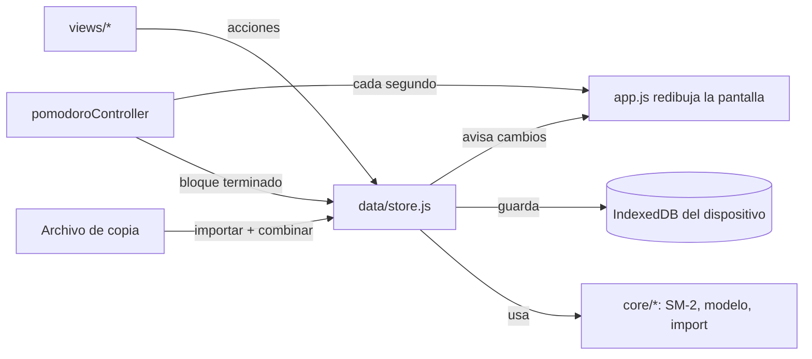

# Versión web: cómo funciona el código

La versión web (`web/`) es una **PWA** (aplicación web progresiva): HTML, CSS y
JavaScript sin frameworks ni dependencias externas, que se instala desde el
navegador y funciona sin conexión. Los casos de uso son los mismos que los de la
app nativa ([CASOS_DE_USO.md](CASOS_DE_USO.md)); las diferencias están al final.

## Estructura

```
web/
├── public/                     Lo que se publica
│   ├── index.html              Página única + política de seguridad (CSP)
│   ├── manifest.webmanifest    Nombre, ícono y modo pantalla completa al instalar
│   ├── _headers                Cabeceras de seguridad (Netlify / Cloudflare Pages)
│   ├── css/app.css             Estilos y paleta (mismos colores que la app nativa)
│   ├── fonts/                  Tipografías propias (sin pedir nada a Google)
│   ├── icons/                  Íconos de la app
│   ├── strokes/                Trazos de kana y kanji (KanjiVG, CC BY-SA 3.0)
│   ├── dict/                   Diccionario sin conexión (JMdict y KANJIDIC2, CC BY-SA 4.0)
│   └── js/
│       ├── app.js              Arranque, navegación, reloj, instalación
│       ├── core/               Lógica pura, sin navegador (tiene pruebas)
│       │   ├── sm2.js          Algoritmo de repaso espaciado
│       │   ├── pomodoro.js     Máquina de estados del temporizador
│       │   ├── model.js        Mazos/tarjetas/sesiones, consultas y combinación (sync)
│       │   ├── transfer.js     Importar y exportar (Mnemo, Anki, copia completa, preguntas)
│       │   ├── sanitize.js     Limpieza de texto y validaciones
│       │   ├── japanese.js     Kana, romaji → kana y corrección tolerante de respuestas
│       │   ├── strokes.js      Comparación de trazos dibujados con los de referencia
│       │   ├── dictionary.js   Búsqueda en el diccionario (kanji, kana, romaji, significado)
│       │   ├── listening.js    Espacios a completar y comparación del dictado
│       │   └── practice.js     Palabras para practicar a partir de las tarjetas
│       ├── data/
│       │   ├── storage.js      IndexedDB (con respaldo en localStorage)
│       │   └── store.js        Estado en memoria + todas las acciones que lo cambian
│       ├── services/           Voz, sonido, pantalla encendida, archivos, Pomodoro
│       ├── ui/                 DOM, componentes, hojas, avisos, pizarra de escritura, listas de kanji
│       └── views/              Pantallas: mazos, repaso, diccionario, Pomodoro, sesiones, ajustes
│           └── practice/       Práctica: escritura, kanji de memoria, preguntas, pronunciación, listening
├── src/sw.template.js          Service worker (modo sin conexión)
├── scripts/build.mjs           Arma dist/ y dist-preview/
├── scripts/serve.mjs           Servidor local con las cabeceras de producción
├── scripts/strokes-from-kanjivg.mjs  Regenera public/strokes/ desde KanjiVG
├── scripts/dict-from-jmdict.mjs      Regenera public/dict/ desde jmdict-simplified
└── tests/                      *.test.mjs (lógica), e2e*.mjs (navegador real)
```

## Flujo de datos



- **Una sola fuente de verdad:** `store.js` tiene el estado en memoria. Las vistas
  nunca lo modifican directo: llaman a una acción (`createCard`, `rateCard`…), que
  pone `updatedAt`, avisa a la interfaz y guarda enseguida.
- **Guardado:** todo el estado se escribe como un solo registro en IndexedDB. Los
  cambios del mismo instante se agrupan en una escritura. Se fuerza el guardado al
  pasar la app a segundo plano.
- **Redibujo:** cada pantalla es una función que devuelve elementos del DOM. Al
  cambiar el estado se vuelve a dibujar la pantalla actual, conservando el foco y
  el cursor si el usuario estaba escribiendo.

## Sincronización por archivo

Cada mazo, tarjeta y sesión tiene `id` y `updatedAt`. Borrar no elimina el
registro: lo convierte en una "lápida" (`{ id, deleted: true, updatedAt }`) para
que el borrado viaje al otro dispositivo. `mergeStates` recorre la copia importada
y, por cada `id`, se queda con la versión de `updatedAt` más nuevo (en empate, la
local). Es idempotente: importar la misma copia dos veces no cambia nada. Las
lápidas de más de 180 días se limpian al abrir la app.

## Repaso (SM-2)

Igual que la versión nativa: ver [ARQUITECTURA.md](ARQUITECTURA.md#algoritmo-de-repaso-sm-2).
En la web se agregó **deshacer** (botón o tecla Z): guarda una copia de la tarjeta
antes de calificarla y la restaura.

## Pomodoro

`core/pomodoro.js` guarda la hora de fin (`endAt`), no un contador, así el tiempo
es exacto aunque el navegador congele la app. El estado se guarda en el
dispositivo y sobrevive si iOS cierra la app; al volver, si la fase terminó, se
procesa en ese momento. Mientras corre, se pide al sistema mantener la pantalla
encendida (Wake Lock) para que el aviso suene a tiempo: en iPhone/iPad las apps
web no pueden ejecutar código ni notificar con la pantalla apagada.

## Práctica

Seis ejercicios en la pestaña **Práctica** (Escritura, Kanji de memoria, Preguntas, Pronunciación, Listening y ¿Qué escuchaste?). Los que usan audio o escritura a mano
corren en una capa a pantalla completa (`ui/layer.js`), fuera de la pantalla
principal, así un cambio de datos (por ejemplo, que termine un Pomodoro) no los
reinicia.

### Escritura (`views/practice/writing.js`)

- **Idiomas:** `WRITING_LANGUAGES` define, por idioma, sus conjuntos de caracteres y
  de dónde salen los trazos. Hoy solo japonés; para sumar otro se agrega una entrada
  con sus datos de trazos. El idioma elegido se recuerda (preferencia `writeLang`).
- **Conjuntos:** kana, tus **listas de kanji** (`kanjiSets` en el modelo:
  `{ id, name, chars }`, se sincronizan en la copia como todo) y los kanji de tus
  mazos. Las listas se crean, editan y amplían desde Escritura (`ui/kanjiLists.js`) o
  desde el Diccionario. Al pegar un texto quedan solo los kanji, sin repetir.
- **Datos de cada kanji** (`services/kanjiDetails.js`): el significado sale de tu
  tarjeta de kanji si la hay; si no, del diccionario (KANJIDIC2, en español cuando
  existe). Lecturas on/kun y cantidad de trazos, del diccionario.
- **Bien escrito:** los trazos quedan en verde con un tick chico cada uno; al
  terminar, tick grande y salto automático al siguiente a los 1,4 s (se cancela si
  el usuario navega o reintenta).
- **Opciones** (en el panel, se recuerdan): "Pasar solo al siguiente"
  (`writeAutoNext`; apagado, te quedás mirando cómo quedó) y "Mostrar los trazos al
  abrir" (`writeAutoAnimate`; apagado, no se anima solo y no te "spoilea" el
  carácter). Kanji de memoria tiene su propio "Pasar solo al siguiente"
  (`recallAutoNext`).

- **Datos:** los trazos vienen de [KanjiVG](https://kanjivg.tagaini.net) (orden de
  trazos japonés). `scripts/strokes-from-kanjivg.mjs` los guarda en
  `public/strokes/<bloque>.json`, un archivo por cada 256 códigos Unicode
  (`030.json` = kana; los kanji en 83 archivos, 6,5 MB en total). La app pide solo
  el bloque que necesita; el de kana se instala con la app y los de kanji los
  guarda el service worker la primera vez que se usan (caché `mnemo-strokes-v1`,
  que no se borra al actualizar la app).
- **Animación:** cada trazo es un `<path>` SVG que se dibuja animando
  `stroke-dashoffset`, con el número de orden al lado.
- **Pizarra** (`ui/writingBoard.js`): la comparten Escritura y Kanji de memoria. Se
  dibuja con eventos de puntero (dedo, mouse o Apple Pencil; si aparece el lápiz, se
  ignoran los toques de la palma).
- **Corrección** (`core/strokes.js`), pensada para letra real (chica, corrida,
  torcida, temblorosa) sin aceptar cualquier cosa:
  1. **Ajuste a tu letra:** con los trazos que ya salieron bien se estima una escala
     y un desplazamiento (mínimos cuadrados, con la escala tirada hacia 1 cuando hay
     pocos datos). El trazo nuevo se compara después de deshacer ese ajuste, así un
     kanji escrito chico en una esquina vale igual.
  2. Se re-muestrea a 32 puntos y se suaviza el temblor.
  3. Se mira por separado: **forma** (los dos trazos centrados), **dirección**
     inicio→fin (hasta ~32°), **lugar** (centro del trazo; margen amplio en el primer
     trazo) y **largo** (entre 0,38 y 2,6 veces el modelo). Los márgenes crecen con
     el largo del trazo y se multiplican por `leniency` (1 en Escritura, 1,25 en
     Kanji de memoria).
  4. **Orden:** si lo dibujado coincide claramente mejor con un trazo que viene
     después, no se acepta y se avisa "ese trazo va después".
  5. Si coincide al revés, avisa que la dirección está invertida. Tras dos errores
     en el mismo trazo, se anima ese trazo como pista.
  6. **Trazo en dos partes** (`startsLike`): si levantás el dedo a mitad de un trazo
     que va de un tirón (la esquina de 口, 日, 月) y lo dibujado coincide con el
     comienzo, no es error: queda punteado, se espera la otra parte y se juntan.
  7. **Para no quedar trabado:** desde el tercer intento en el mismo trazo se compara
     también sin el ajuste a tu letra y con 1,4× de margen (el error ya se contó).

  Con letra simulada (escala, rotación, desplazamiento y temblor al azar) sobre 64
  kanji de Genki, la versión anterior aceptaba el 19 % de los trazos de letra chica y
  corrida; esta acepta el 99 %, y sigue rechazando ~93 % de los trazos hechos en
  otro orden.
- Guarda cuántas veces practicaste cada carácter (preferencia local) y lo marca
  en la grilla (punto amarillo: practicado; verde: alguna vez sin errores).

### Kanji de memoria (`views/practice/kanjiRecall.js`)

Se elige una fuente (lista propia o kanji de un mazo), cantidad y orden ("primero
los que más me cuestan" usa las estadísticas `recallStats` guardadas en el
dispositivo). Se muestra el significado y las lecturas, y hay que escribir el kanji
en blanco, sin guía. **Pista** anima el trazo que toca; **No me acuerdo** muestra el
kanji completo para copiarlo. Nota por kanji: ◎ perfecto, ○ con errores, △ con ayuda
(sello sobre la pizarra) y salto automático. Al final: precisión (trazos /
(trazos + errores + pistas)), lista con la nota de cada uno y "Repetir los que
costaron".

### Preguntas (`views/practice/quizzes.js`)

Cuestionarios (`quizzes` en el modelo, se sincronizan como el resto):
`{ id, name, questions: [{ prompt, answers[], note }] }`. Se crean a mano, se
importan desde texto (`pregunta⇥respuesta1 / respuesta2⇥nota`) o se generan
desde un mazo (español → japonés o japonés → español). Las preguntas falladas
vuelven a aparecer al final.

**Corrección tolerante** (`core/japanese.js`, `matchesAnswer`): da igual hiragana,
katakana o romaji (`neko` = `ねこ` = `ネコ`; las partículas sueltas `wa`, `e`, `o` = は, へ, を), espacios, puntuación y vocales largas
(`koohii` = `コーヒー`, `sensee` = `せんせい`); en español, mayúsculas y tildes.
`すき（な）` acepta `すき` y `すきな`; `comer; tomar` acepta cada significado.

### Pronunciación (`views/practice/audio.js`)

Tres formas, porque no todas funcionan en todos lados:

1. **Reconocimiento de voz del navegador** (`SpeechRecognition`, japonés). Funciona
   en Safari y Chrome. **Apple no lo habilita en las apps agregadas a la pantalla
   de inicio** (WebKit bug 225298), así que en la app instalada no aparece.
2. **Dictado del teclado:** se toca el campo y se usa el micrófono del teclado
   japonés. Funciona también en la app instalada.
3. **Grabarme y comparar:** graba con el micrófono, reproduce la grabación junto al
   modelo y uno mismo marca si salió bien. El audio no sale del dispositivo.

Lo reconocido se corrige con `core/speech.js` (`judgeSpoken`), probando las 5
alternativas que da el reconocimiento:

1. igual que una respuesta escrita (kana, kanji o romaji de la tarjeta; `1時` = `一時`);
2. **homófonos:** si escribió otro kanji que se lee igual (翻 en vez de 本), se busca
   su lectura en el diccionario (`readingsOf`) y vale;
3. **vocales largas o cortas** mezcladas (ほーん = ほん, とーきょー = とうきょう);
4. **"casi":** un solo sonido distinto en palabras de 2 sílabas o más (ほ en vez de
   ほん, porque la ん final casi no se escuchó). Cuenta como bien y te dice qué marcar
   (por ejemplo, "Marcá un poco más la ん del final").

### ¿Qué escuchaste? (`views/practice/audio.js`)

La voz del sistema dice una palabra de un mazo y se elige el significado entre
cuatro opciones (los otros tres salen del mismo mazo). Si el dispositivo no tiene
voz japonesa, la app explica cómo instalarla.

### Listening (`views/practice/listening.js`, `core/listening.js`)

Ejercicios de textos largos (`listenings` en el modelo):
`{ id, title, level, language, transcript, reading, note, questions[], mediaId, mediaName, mediaType }`.

- **Audio o video propio:** el archivo se guarda como `Blob` en IndexedDB (almacén
  `media`, base v2), aparte del estado. **No viaja en la copia de seguridad** (sería
  enorme); para pasarlo se exporta el ejercicio solo (`.mnemo-listening.json`, con el
  audio en base64, hasta 90 MB). Al importar se valida tipo MIME (solo audio/* y
  video/*) y tamaño.
- **Sin archivo:** la voz del sistema lee la transcripción frase por frase
  (`sentences()`), a la velocidad elegida.
- **Completar espacios** (`clozeParts`): si la transcripción tiene `[palabra|otra]`,
  esos son los espacios; si no, se segmenta con `Intl.Segmenter` y se eligen
  palabras cada 7 / 4 / 2 según el nivel, salteando partículas y puntuación.
- **Dictado completo** (`compareDictation`): normaliza (kana, sin espacios ni
  puntuación, romaji → kana, partículas `wa/e/o`) y compara con la transcripción y
  con la lectura en kana por subsecuencia común más larga; devuelve el porcentaje
  y qué caracteres faltaron.
- **Ejemplos** (`listeningExamples.js`): tres textos originales para probar.

## Diccionario (`views/dictionary.js`)

- **Datos:** [JMdict y KANJIDIC2](https://www.edrdg.org) (© EDRDG, CC BY-SA 4.0) en el
  formato de [jmdict-simplified](https://github.com/scriptin/jmdict-simplified).
  `scripts/dict-from-jmdict.mjs` junta las palabras comunes (glosas en inglés) con
  todas las que tienen traducción al español: ~41.000 palabras (`dict/words.json`,
  5,3 MB; 1,7 MB comprimido) y ~3.100 kanji de uso habitual (`dict/kanji.json`).
  Por qué no una API: Takoboto no tiene API pública (usa estos mismos datos dentro
  de la app) y la API de Jisho no es oficial ni permite llamadas desde otra web.
  Así además funciona sin conexión y no se manda lo que buscás a ningún servidor.
- **Carga:** los archivos se piden al abrir el Diccionario (o al practicar un kanji)
  y el service worker los guarda en `mnemo-dict-v1` (se usa lo guardado y se
  actualiza en segundo plano).
- **Búsqueda** (`core/dictionary.js`): kanji y kana (exacto, prefijo, contiene),
  romaji pasado a kana, y significado en español o inglés (glosa exacta, palabra
  inicial o palabra dentro). Orden: calidad de la coincidencia, palabras comunes,
  posición de la glosa en la entrada y frecuencia de sus kanji. ~20 ms por búsqueda.
- **Acciones:** escuchar, agregar la palabra como tarjeta a un mazo, ver cada kanji
  (significado, lecturas, trazos, nivel JLPT aproximado, palabras de ejemplo),
  practicarlo en Escritura, sumarlo a una lista, y abrir la búsqueda en Takoboto o
  Jisho (enlaces externos con `noopener noreferrer`; no se les manda nada más).

## Modo sin conexión

`scripts/build.mjs` calcula un número de versión a partir del contenido de los
archivos y genera `sw.js` con la lista completa. Al instalarse, el service worker
guarda todos los archivos en un caché propio de esa versión; las páginas se sirven
desde ahí. Cuando se publica una versión nueva, se descarga entera, se activa y la
app se recarga una vez (después de guardar los datos).

## Seguridad

- **Sin servidor, sin cuentas, sin claves:** no hay nada que filtrar del lado del servidor.
- **CSP estricta** (en `_headers` y en `index.html`): solo se ejecuta código de la propia
  app; nada en línea ni de terceros. Ni las tipografías se piden a otro sitio.
- **El texto del usuario nunca se interpreta como HTML:** `ui/dom.js` crea todo con
  nodos de texto (no hay `innerHTML` en la app). La prueba de navegador verifica que
  una tarjeta con `` se muestre literal.
- **Importaciones como datos no confiables:** límites de tamaño (5 MB por mazo,
  25 MB por copia) y de cantidad, ids validados, números y fechas acotados, texto
  limpiado (`sanitize.js`).
- **Otras cabeceras:** `nosniff`, sin referrer, sin cámara ni ubicación (el
  micrófono solo para la propia app), la app no se puede embeber en otro sitio.
- **Micrófono:** se pide permiso recién al tocar "Decirlo" o "Grabarme". Las
  grabaciones quedan en memoria y se descartan al salir. El reconocimiento de voz
  automático lo hace el navegador (Apple o Google) y puede enviar el audio a sus
  servidores: la app lo avisa antes de empezar.

## Pruebas

| Archivo | Qué verifica |
|---|---|
| `tests/core.test.mjs` | SM-2, Pomodoro, sanitización, consultas, combinación de copias, importación (Anki, nativa, archivos maliciosos) |
| `tests/listening.test.mjs` | Espacios con corchetes y automáticos por nivel, frases, comparación del dictado, importar/exportar ejercicios (tipos y tamaños) |
| `tests/kanji.test.mjs` | Listas de kanji (limpieza, copia), búsqueda en el diccionario (kanji, kana, romaji, significado, desempates) y los datos reales generados |
| `tests/e2e-kanji.mjs` | En Chromium: crear y ampliar una lista, escribir 日 chico/corrido/torcido, opciones de no avanzar y no animar, 口 con un trazo en dos partes, Kanji de memoria (perfecto y con "No me acuerdo"), diccionario (significado, romaji, kanji, tarjeta, sumar a lista), celular sin desbordes |
| `tests/practice.test.mjs` | Romaji → kana, corrección tolerante, comparación de trazos (bien, lejos, al revés, puntos, letra chica y corrida, torcido, en dos partes), pronunciación (homófonos, vocales largas, "casi"), palabras desde tarjetas, cuestionarios en la copia |
| `tests/e2e-practice.mjs` | En Chromium (iPad horizontal y celular): trazos simulados de あ (tick y salto automático), い (mal) y 曜, generar y responder preguntas, "¿qué escuchaste?", pronunciación con dictado del teclado, listening (completar, preguntas y dictado completo) |
| `tests/e2e.mjs` | En Chromium a tamaño iPhone (claro) e iPad (oscuro): alta de tarjeta, XSS, repaso con deshacer, Pomodoro y anotación, sesiones, exportar/importar, datos tras recargar, modo sin conexión, sin desbordes horizontales ni errores de consola |

## Diferencias con la app nativa

| Tema | Web | Nativa |
|---|---|---|
| Datos | IndexedDB del navegador | SwiftData |
| Sincronización | Manual por archivo, con combinación | Automática por iCloud |
| Aviso del Pomodoro con la app cerrada | No disponible | Notificación local |
| Deshacer en el repaso | Sí | No |
| Práctica (escritura, preguntas, pronunciación, escucha) | Sí | No (por ahora) |
| Formato de mazo exportado | El mismo (compatibles) | El mismo |
